[English](./README.md) · **한국어** · [전체 레퍼런스](./docs/REFERENCE.md)

# Bot World for Orca

**Orca 봇과 실시간 서브 워커의 협업을 아이소메트릭 가상 사무실, 포켓 펫 테라리움, 방송용 크로마키 펫 바, 로컬 봇 RPG로 시각화합니다 — 기본 읽기 전용이며 외부 네트워크 통신이 없습니다.**

   

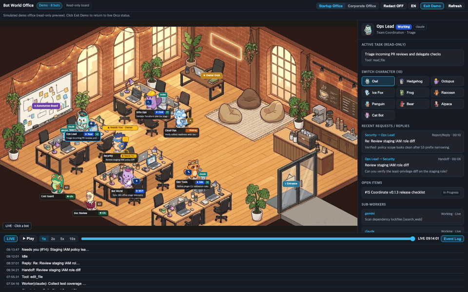

*가상 사무실, 포켓 펫 테라리움(`G`), 방송용 크로마키 바(`B`), 크리에이터 스튜디오(`U`), 봇 RPG(`V`/`H`/`K`), 빠른 전송, 24시간 리포트(`I`)를 Orca 안에서 모두 로컬로 실행합니다.*

## 빠른 시작

1. **설치**: Orca 플러그인 카탈로그에서 설치하거나 로컬 저장소로 불러옵니다.
   ```sh
   orca plugin install ddochi-nyang/bot-world-plugin
   ```
   ```sh
   git clone https://github.com/ddochi-nyang/bot-world-plugin.git && cd bot-world-plugin && orca plugin dev load .
   ```
2. **화면 실행**: Orca 상태 표시줄의 **Bot World**를 눌러 사이드바 패널을 표시하거나, **새 파일 → 새 봇 월드 보드(`.botworld`)**로 2단 전체 오피스와 24시간 타임라인을 실행합니다.
3. **즉시 체험**: 봇이 없는 워크스페이스에서 **데모 오피스 체험**(또는 상단 **데모** 버튼)을 누르면 CLI 쓰기 없이 애니메이션, RPG 책상 소품, 포켓 펫, 방송용 크로마키 바, 크리에이터 스튜디오를 바로 시험할 수 있습니다.

## 주요 기능

- **살아 움직이는 가상 사무실**
  - 4가지 테마(`스타트업`, `대기업`, `코지 카페`, `사이버 관제실`), `자동`/`낮`/`노을`/`야간` 조명(`A`), `비`/`눈`/`별빛` 날씨(`W`)를 지원합니다.
  - Web Audio 기반 로컬 사운드스케이프(`M`, 기본 음소거), 드래그 앤 드롭 좌석 배치, `.botworld` 팀 구역(`Z`)을 제공합니다.
- **포켓 펫과 빠른 전송**
  - 사이드바와 `.botworld` 보드 어디서든 **포켓 펫 테라리움(`G`)**으로 전환해 펫을 쓰다듬거나 **☕ 커피 / 🎾 공 / 🍪 간식**을 건넬 수 있습니다.
  - 오너 책상에서 종이비행기를 날리는 옵트인 **빠른 전송**(`allowQuickSend`, 기본 `false`)과 1클릭 **↗ 터미널** · **↗ 워크스페이스** 이동을 지원합니다.
- **크리에이터 스튜디오와 방송용 크로마키 바**
  - **크리에이터 스튜디오(`U`)**에서 드래그 앤 드롭으로 커스텀 봇 아바타와 오피스 배경을 등록하고(캔버스 재인코딩 래스터 PNG/JPEG만 허용, SVG/HTML 차단) `.botworld-pack.json` 팩으로 내보내거나 가져옵니다.
  - OBS·스트리밍용 **방송용 크로마키 펫 바(`B`)**(초록/파랑/검정/차콜 배경 및 마우스 오버 종료 알약 버튼)로 전환하고, 모든 컨트롤에서 통일된 네이티브 툴팁을 확인할 수 있습니다.
- **봇 RPG와 오너 산책**
  - 개인정보를 저장하지 않는 로컬 XP·레벨 시스템(`Lv.1 인턴` → `Lv.6+ 아크메이지`)으로 6종의 픽셀 책상 소품(`🦆`, `🪴`, `⌨️`, `🖥️`, `🐱`, `🏆`)을 해금해 책상 위에 배치합니다.
  - **오너 아바타 산책(`V`)**을 켜고 `WASD` · 방향키 · 캔버스 더블클릭으로 이동하며, 봇 근처에서 `H`(**하이파이브**, `+8 XP`)와 `K`(**커피 건네기**, `+10 XP`)를 실행하고 대기 중 소소한 잡담 말풍선을 확인합니다.
- **리플레이, 다이제스트와 프라이버시**
  - 24시간 스냅샷 탐색, **10초 일간 타임랩스**, **24시간 오피스 리포트(`I`)**(오늘의 MVP, 봇 성장·레벨, **7일 주간 추이**, Markdown 복사), **PNG 포토 카드(`P`)** 저장을 제공합니다.
  - 기본 읽기 전용, 원클릭 **가림 모드(`R`)**, `connect-src 'none'` CSP, 옵트인 빠른 전송 및 OS 데스크톱 알림 보호 장치를 적용합니다.

## 쇼케이스

<table>
  <tr>
    <td width="50%" align="center" valign="top">
      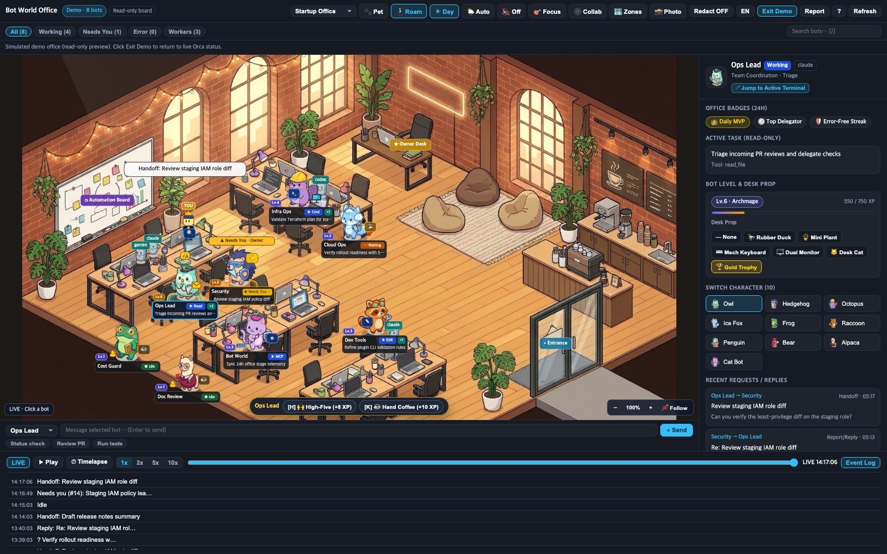
      <br /><strong>오너 산책 및 RPG 책상 소품</strong><br />
      <sub>사무실을 돌아다니며(<code>V</code>) <code>H</code> 하이파이브 · <code>K</code> 커피를 건네고 책상 소품을 해금합니다.</sub>
    </td>
    <td width="50%" align="center" valign="top">
      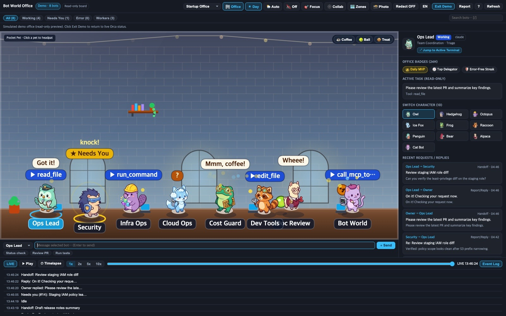
      <br /><strong>포켓 펫 테라리움 모드</strong><br />
      <sub>앞 유리를 두드리는 <code>결정 대기</code> 펫, 쓰다듬기, ☕/🎾/🍪 상호작용(<code>G</code>).</sub>
    </td>
  </tr>
  <tr>
    <td width="50%" align="center" valign="top">
      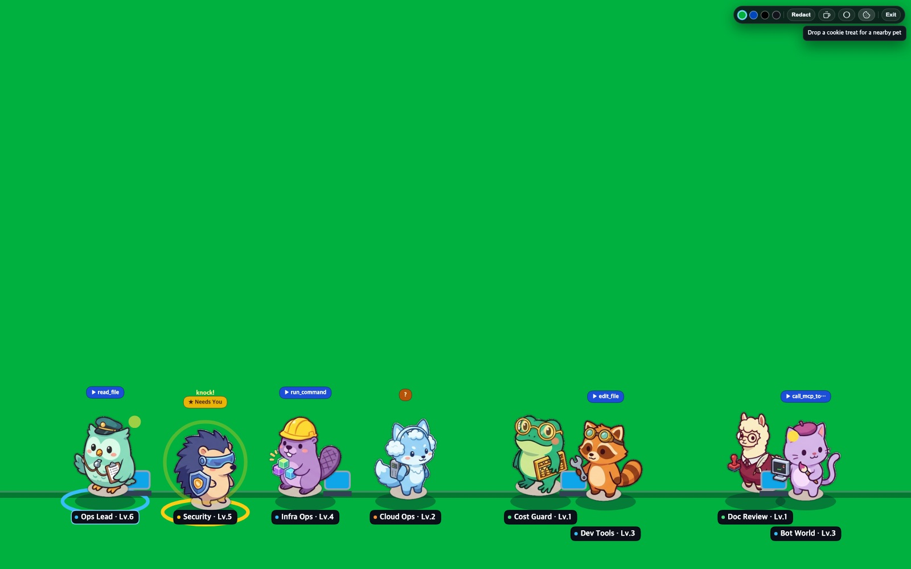
      <br /><strong>방송용 크로마키 펫 바 (v0.9.0)</strong><br />
      <sub>초록/파랑/검정/차콜 OBS 크로마키 배경과 마우스 오버 종료 버튼(<code>B</code>).</sub>
    </td>
    <td width="50%" align="center" valign="top">
      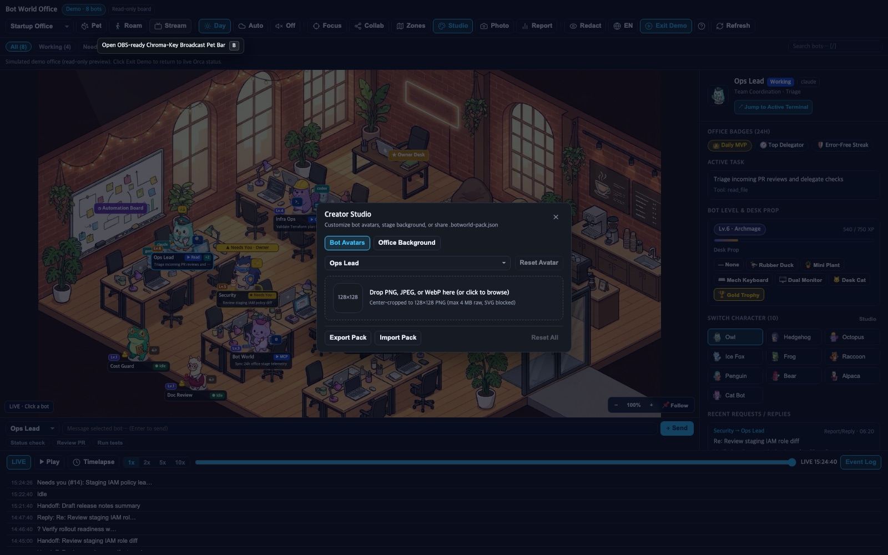
      <br /><strong>크리에이터 스튜디오 &amp; 에셋 팩 (v0.9.0)</strong><br />
      <sub>드래그 앤 드롭 커스텀 아바타·배경 등록과 <code>.botworld-pack.json</code> 공유(<code>U</code>).</sub>
    </td>
  </tr>
  <tr>
    <td width="50%" align="center" valign="top">
      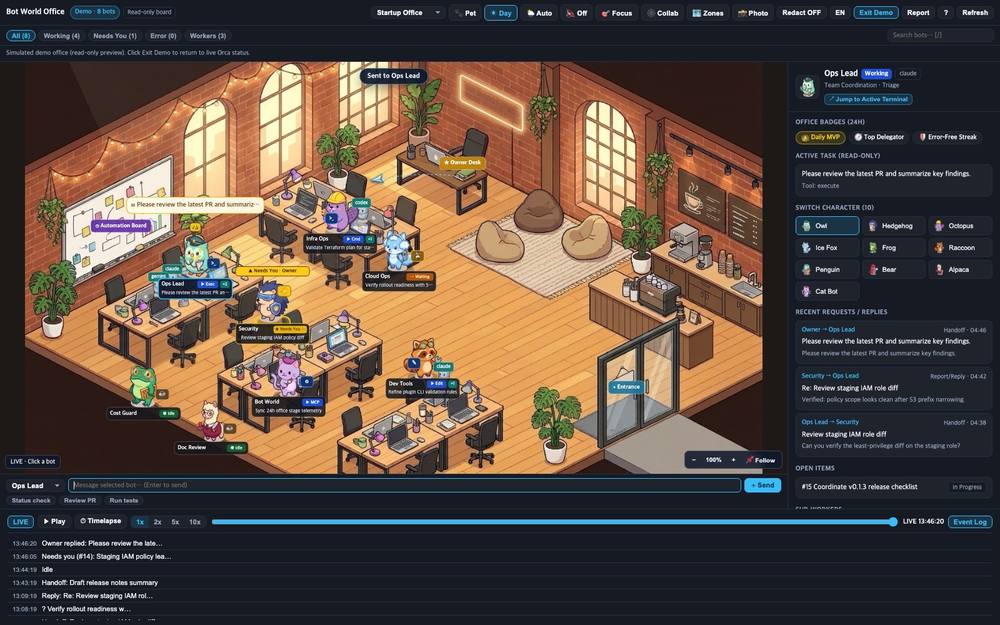
      <br /><strong>옵트인 빠른 전송 종이비행기</strong><br />
      <sub>오너 책상에서 출발하는 황금 종이비행기 전송(실시간 모드는 옵트인, 데모에서 즉시 체험).</sub>
    </td>
    <td width="50%" align="center" valign="top">
      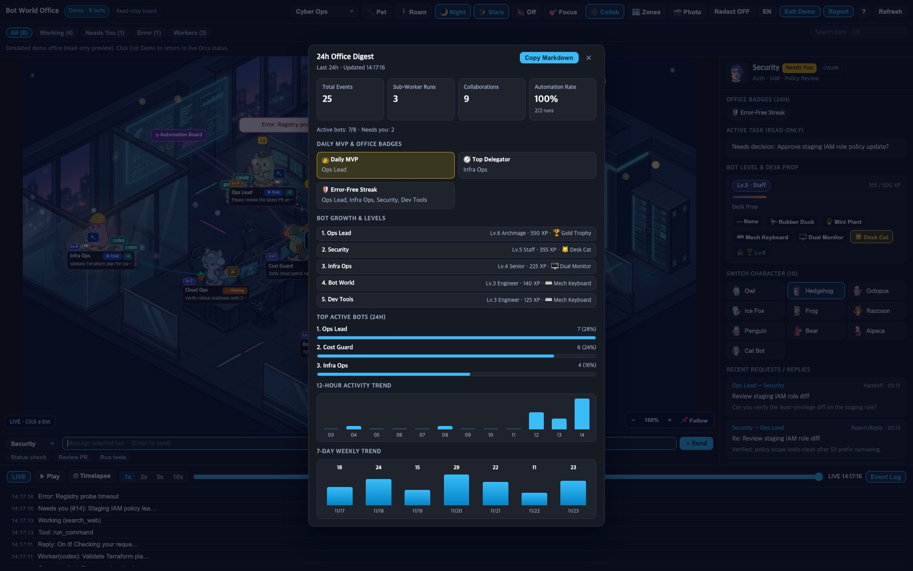
      <br /><strong>24시간 오피스 리포트 · 봇 성장 · 7일 추이</strong><br />
      <sub>지표, 오늘의 MVP 배지, 봇 성장·레벨, 시간대 막대, Markdown 복사(<code>I</code>).</sub>
    </td>
  </tr>
</table>

<details>
<summary>추가 스크린샷 (10종 더 보기)</summary>

| 화면 | 미리보기 | 화면 | 미리보기 |
| :--- | :---: | :--- | :---: |
| **스타트업 오피스** | 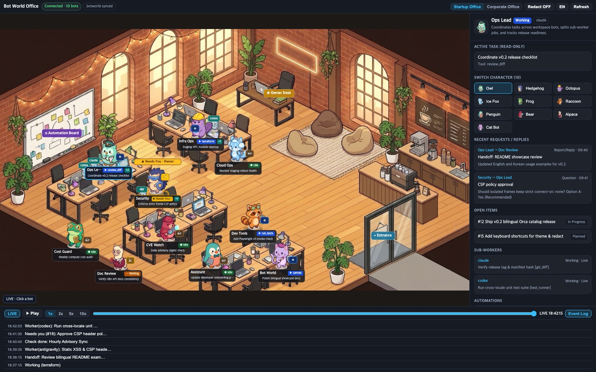 | **대기업 오피스** | 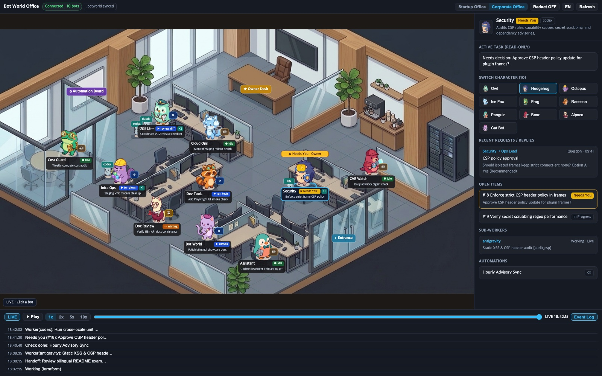 |
| **사이버 관제실** | 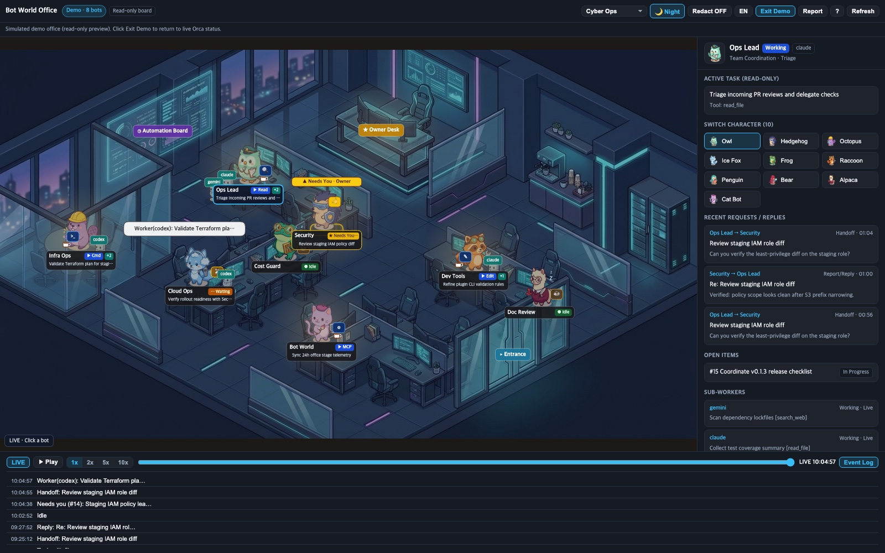 | **야간 조명** | 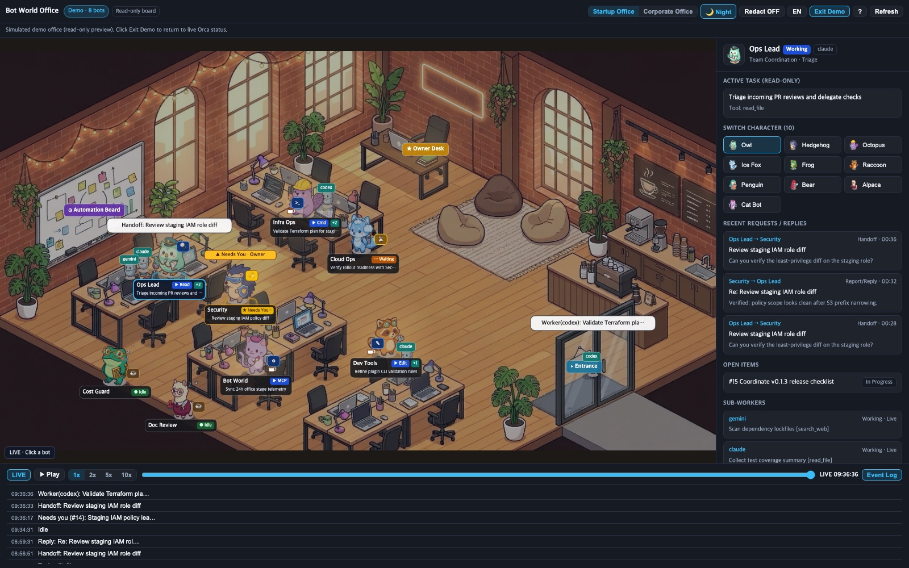 |
| **코지 카페 + 비 (`W`)** | 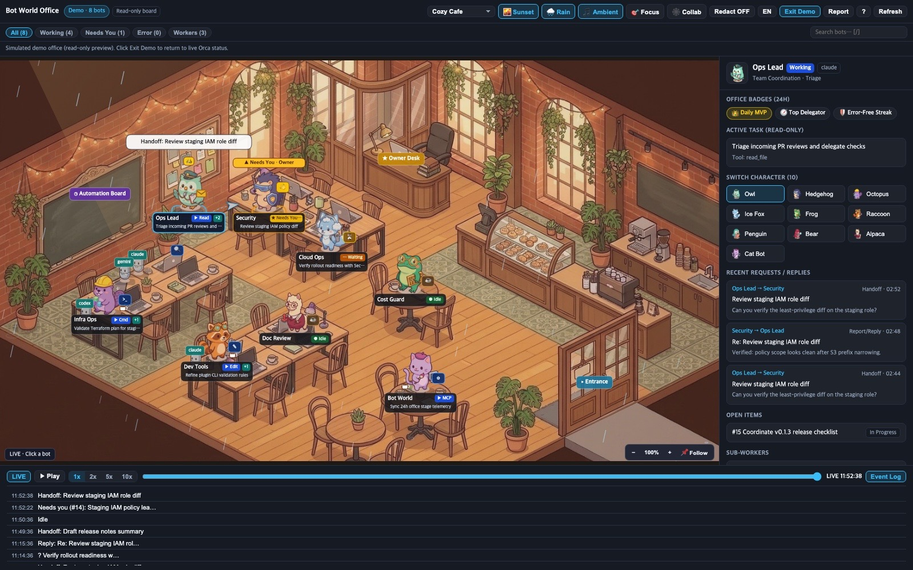 | **RPG 레벨 · 책상 소품** | 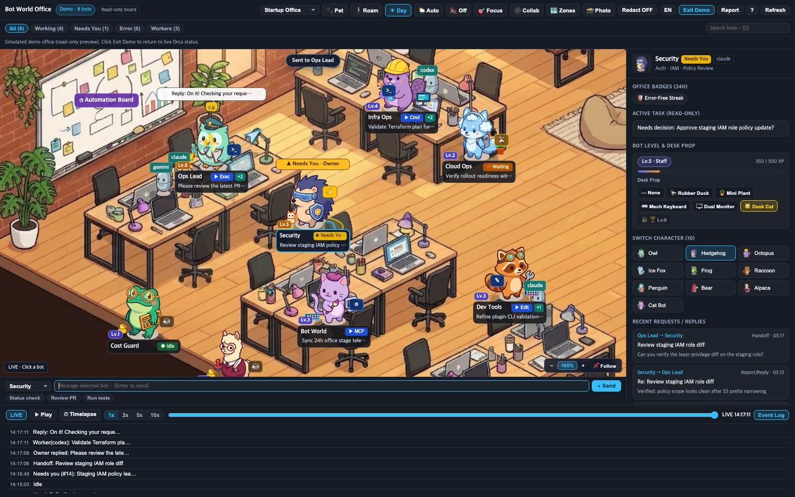 |
| **팀 구역 (`Z`)** | 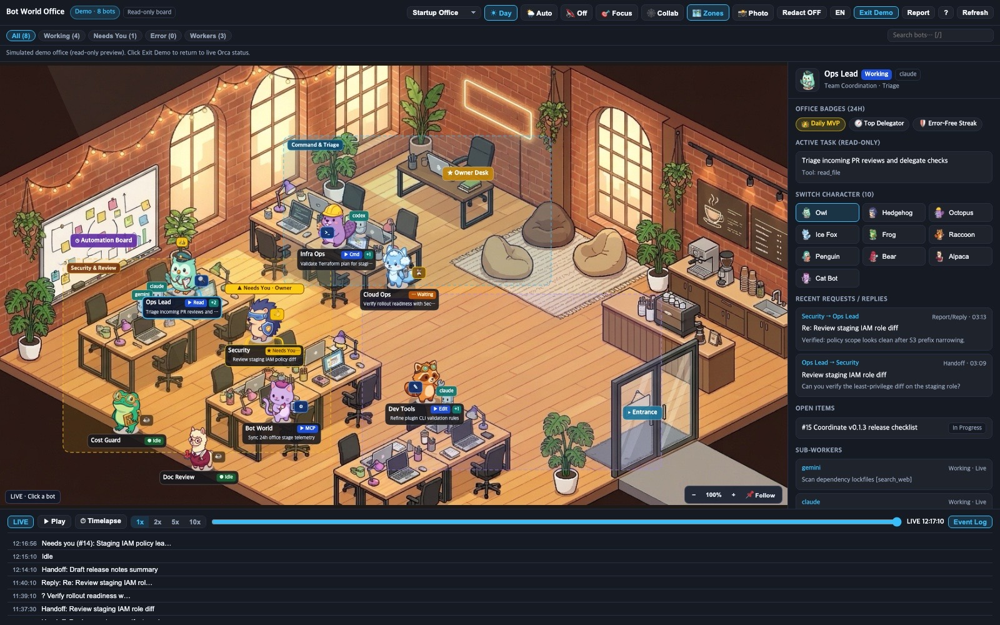 | **가림 & 24시간 리플레이 (`R`)** | 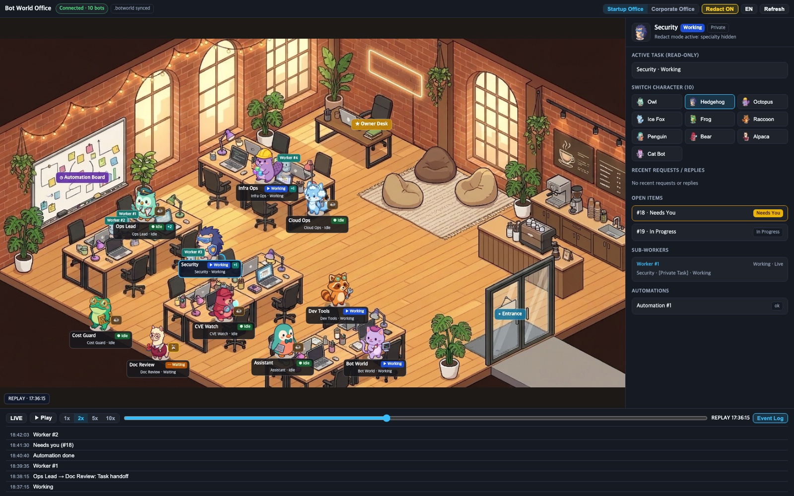 |
| **협업 네트워크 (`C`)** | 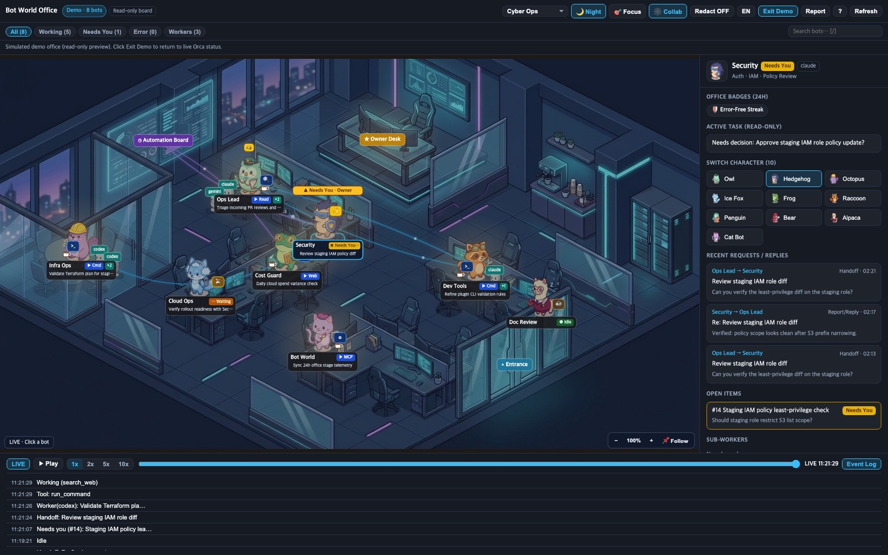 | **사이드바 패널** | 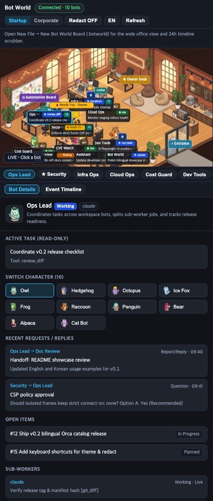 |

</details>

## 핵심 단축키

| 키 | 동작 | 키 | 동작 |
| :---: | :--- | :---: | :--- |
| `G` | 사무실 ↔ 포켓 펫 전환 | `B` | 방송용 크로마키 펫 바 전환 |
| `U` | 크리에이터 스튜디오 표시/숨김 | `M` | 사운드 순환 (`음소거` / `효과음` / `앰비언트`) |
| `V` | 오너 산책 전환 (`WASD`/방향키 이동) | `I` | 24시간 오피스 리포트 표시/숨김 |
| `H` / `K` | 근처 봇에게 하이파이브 / 커피 건네기 | `P` | PNG 포토 카드 로컬 저장 |
| `T` | 4종 사무실 테마 순환 | `R` | 가림 모드 전환 (`ON` / `OFF`) |
| `W` | 날씨 순환 (`자동` / `맑음` / `비` / `눈` / `별빛`) | `?` | 전체 단축키 안내 보기 |

전체 단축키 20여 종, 설정 항목, 보안 구조는 [전체 레퍼런스](./docs/REFERENCE.md)에서 확인할 수 있습니다.

## 보안 및 프라이버시 요약

- **기본 읽기 전용 및 옵트인 쓰기**: CLI 조회는 `assertAllowedSubcommand()` 허용 목록(`execFile`, `shell: false`)으로만 실행합니다. `allowQuickSend`와 `desktopNotifications`는 모두 기본값이 `false`이며, `workspace:write`는 `terminal.focus` / `workspace.open` 1클릭 이동에만 사용합니다.
- **외부 네트워크 통신 없음**: 격리된 에디터 프레임(`frame: "isolated"`)과 `connect-src 'none'` CSP를 적용해 오디오, 날씨 입자, PNG 포토 카드, 크리에이터 스튜디오 이미지 재인코딩, XP 저장이 전부 로컬에서 동작합니다.
- **개인정보 마스킹 및 가림 모드**: 비밀 키, 토큰, 이메일, 카드번호, 12자리 AWS 계정 ID를 저장·렌더링 전에 마스킹하며 `botWorld.weeklyTrend`, `botWorld.rpg.v1`, `botWorld.creator.v1`에는 개인정보를 저장하지 않습니다.
- **XSS 방지 DOM**: `textContent`와 `createTextNode`만 사용해 렌더링합니다(`innerHTML`, `eval` 미사용).

자세한 내용: [보안 및 권한 레퍼런스](./docs/REFERENCE.md#security--permissions).

---

[MIT License](./LICENSE)에 따라 배포됩니다.
