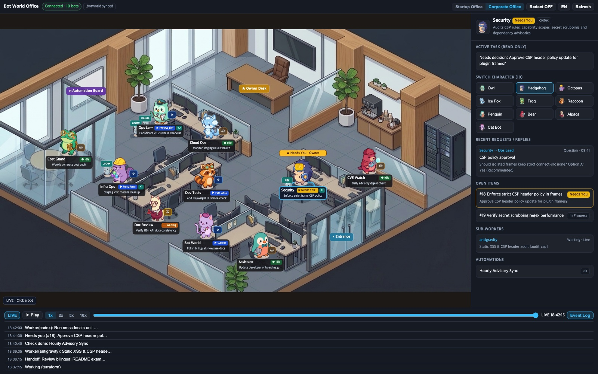
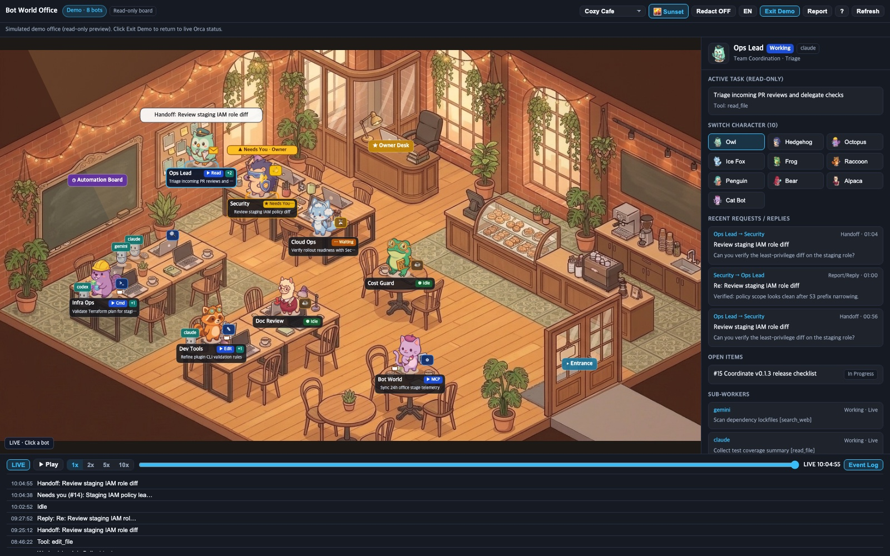
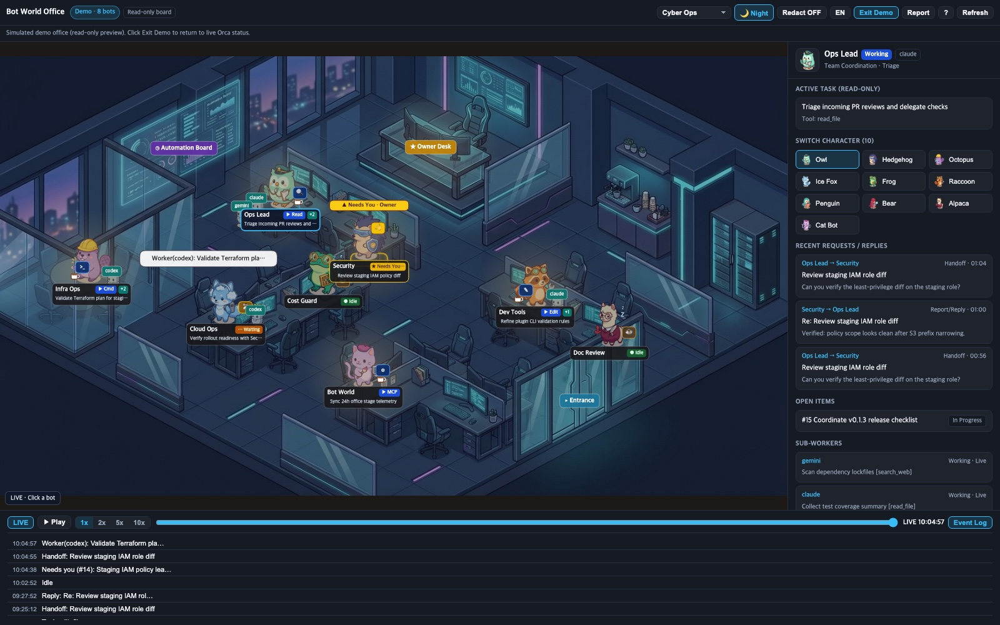
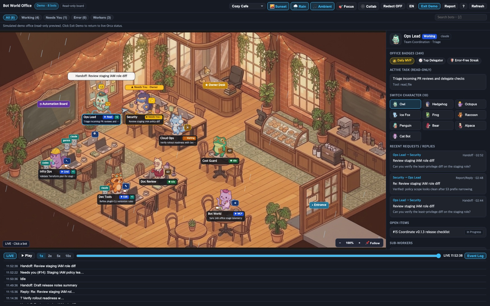
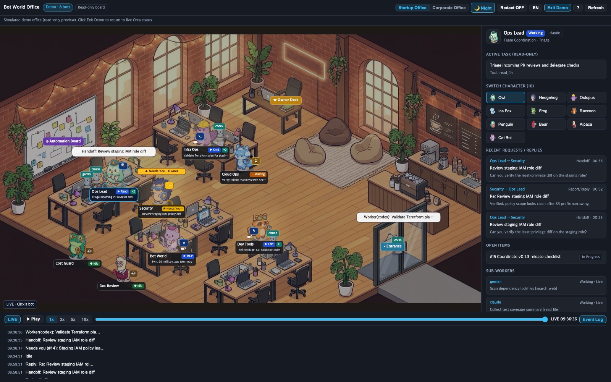

<div align="center">
  
  <h1>Bot World</h1>
  <p><strong>Read-only virtual office visualizer (HTML5 Canvas) for Orca bots and live sub-workers.</strong></p>
  <p>
    <code>Read-Only</code> · <code>4 Office Themes</code> · <code>1-Click Photo Card</code> · <code>10s Daily Timelapse</code> · <code>7-Day Weekly Trend</code> · <code>Team Zones</code> · <code>Smart Camera</code> · <code>Collab Network</code> · <code>Cozy Sound &amp; Weather</code> · <code>Bilingual EN / 한국어</code> · <code>Redact Mode</code> · <code>24h Replay</code>
  </p>
  <br />
  
  <p><em>Interactive preview (v0.6.0 Share &amp; Replay+): 1-Click PNG Photo Card (<code>P</code>), 10-Second Daily Timelapse, 7-Day Weekly Activity Trend &amp; Daily MVP Badges in the Office Digest Report (<code>I</code>), translucent <code>.botworld</code> Team Zones (<code>Z</code>), 4 isometric office themes (Startup, Corporate, Cozy Cafe, Cyber Ops), Day / Sunset / Night atmosphere, Rain / Snow / Starlight weather &amp; procedural Web Audio soundscapes, Smart Camera &amp; collaboration network overlay, Redact Mode + 24h Replay, and instant EN / 한국어 toggle.</em></p>
</div>

---

## Showcase Gallery

### 4 Office Themes (`Startup` · `Corporate` · `Cozy Cafe` · `Cyber Ops`)

Open a `.botworld` file (**New File → New Bot World Board**) for the full two-column office view with live desks, drag-and-drop custom seating, sub-worker helpers, speech bubbles, landmark callouts, and an interactive bot inspector. Press `T` or use the toolbar selector to cycle across all four themes.

| Startup Office | Corporate Office |
| :---: | :---: |
|  |  |
| *Warm studio floor plan with live desks, sub-workers, character switcher, and 24-hour event timeline.* | *Cool glass-walled office highlighting `Needs You` approval badges, open items, and automation status.* |

| Cozy Cafe | Cyber Ops |
| :---: | :---: |
|  |  |
| *Warm botanical cafe studio at sunset with wooden desks, round cafe tables, and flying handoff couriers.* | *Midnight neon operations center with dual monitors, live desk lamps, and idle `Zzz` bubbles.* |

### Command & Focus (`Smart Camera` · `Filters & Search` · `Collab Network`)

Quickly isolate bottlenecks across busy workspaces: press `N` for **Focus Spotlight** on `Needs You` or `Error` bots, toggle **Follow Cam** (`F`) or zoom/pan smoothly (`0` to reset), filter by status chips or press `/` to search, and press `C` to overlay 24-hour weighted collaboration arcs between bots, sub-workers, and the Automation Board.

<div align="center">
  
  <p><em>Command &amp; Focus in Cyber Ops Night mode: 24h collaboration network arcs (<code>C</code>), status filter chips &amp; live search (<code>/</code>), and Smart Camera zoom/follow HUD.</em></p>
</div>

### Share & Replay+ (`Photo Card` · `10s Timelapse` · `Team Zones` — `v0.6.0`)

Share clean snapshots and organize larger offices: press `P` (or click **Photo**) to composite the live stage with a dark-glass KPI, theme, atmosphere, and Redact status banner into a locally downloaded `.png` Photo Card; click **Timelapse** on the replay toolbar to compress the full 24h event window into a smooth 10-second animated highlight run; and press `Z` (or click **Zones**) to toggle translucent `.botworld` Team Zone floor pods managed via the **Team Zones** modal (`Load Starter Pods (3)` or custom add/remove, automatically masked to `Zone #1` / `구역 #1` in Redact Mode).

<div align="center">
  
  <p><em>Team Zones &amp; Share+ (v0.6.0): translucent color-coded floor pods saved in <code>.botworld</code> (<code>Z</code>), 10-second Daily Timelapse playback, and 1-Click PNG Photo Card export (<code>P</code>).</em></p>
</div>

### 24h Daily Office Digest Report (`Daily MVP & Badges` + `7-Day Weekly Trend`)

Press `I` or click **Report** in the toolbar to review a 24-hour activity summary — KPIs (events, sub-worker runs, collaborations, automation rate, and pending owner inputs), **Daily MVP & Office Badges** (`👑 Daily MVP`, `🧭 Top Delegator`, `🦉 Night Owl`, `🛡️ Error-Free Streak`), the **Top 3** active bots, a **12 hourly buckets** activity bar chart, and a **7-Day Weekly Trend** bar chart powered by privacy-safe local daily integer rollups — with 1-click **Copy Markdown** and full **Redact Mode** compliance.

<div align="center">
  
  <p><em>24h Daily Office Digest Report modal: KPIs, Daily MVP &amp; Office Badges, Top 3 active bots, 12 hourly buckets chart, 7-Day Weekly Trend chart, and 1-click Copy Markdown (Redact-safe).</em></p>
</div>

### Cozy Sound & Weather (`v0.5.0`)

Add tactile atmosphere without leaving your editor: press `W` to cycle `Auto / Clear / Rain / Snow / Starlight` weather particles tuned to the active theme and time of day, and press `M` to enable 100% locally synthesized Web Audio cues (`Off` / `Chimes` / `Ambient`) paired with canvas micro-events for errors, daily completion milestones (`5 / 10 / 25 / 50`), and collaborative huddles.

<div align="center">
  
  <p><em>Cozy Cafe Sunset + Rain + Ambient Sound (v0.5.0): falling rain &amp; ground ripples (<code>W</code>), Web Audio ambient soundbed (<code>M</code>), flying envelope handoff courier, and Daily MVP inspector badges.</em></p>
</div>

### Living Office Atmosphere (`Day` · `Sunset` · `Night`)

Cycle `Auto`, `Day`, `Sunset`, and `Night` lighting from the toolbar or press `A` — in `Auto` mode, lighting follows the live clock or shifts seamlessly as you scrub the 24-hour replay timeline. Night mode adds warm desk lamp spotlights over working bots, steaming coffee icons, idle `Zzz` bubbles, and animated sub-worker door commutes alongside curved paper-plane and envelope couriers.

<div align="center">
  
  <p><em>Night atmosphere mode: warm desk lamp spotlights, steaming coffee, idle Zzz bubbles, and a sub-worker entering through the office door.</em></p>
</div>

### Privacy & Time Travel (`Redact Mode` + `24h Timeline Replay`)

Toggle **Redact ON** to mask sensitive task titles, tool names, message summaries, and sub-worker providers, or scrub back through the past 24 hours at `1x`, `2x`, `5x`, or `10x` playback speed.

<div align="center">
  
</div>

### Compact Sidebar Panel

Keep a live office overview docked beside your code and terminals without leaving your workspace.

<table>
  <tr>
    <td width="280" align="center" valign="top">
      
    </td>
    <td valign="top">
      <h4>Everything at a glance in the Orca sidebar</h4>
      <ul>
        <li><strong>Instant Theme &amp; Privacy Toggles</strong>: Cycle all 4 themes (<strong>Startup</strong>, <strong>Corporate</strong>, <strong>Cozy Cafe</strong>, <strong>Cyber Ops</strong>), open the <strong>24h Report</strong>, toggle <strong>Redact ON/OFF</strong>, and switch <strong>EN / 한</strong> directly from the top bar.</li>
        <li><strong>Live Bot Roster</strong>: Quick-select pills highlight bots awaiting your decision (<code>★</code>) alongside active status badges.</li>
        <li><strong>Bot Details &amp; Event Timeline Tabs</strong>: Inspect the active read-only task, recent requests/replies, open items, live sub-workers, linked automations, or switch to the chronological event timeline.</li>
        <li><strong>One-Click Character Picker</strong>: Override any bot's avatar across 10 animal characters right inside the detail pane.</li>
      </ul>
    </td>
  </tr>
</table>

---

## Key Features

- **Dual Surfaces**:
  - **Sidebar Panel (`Bot World`)**: Compact docked canvas, bot roster pills, detail inspector, 24h Report button, and recent event timeline.
  - **Wide `.botworld` Office Board**: Create via **New File → New Bot World Board (`.botworld`)** for a full-screen 2-column stage with a **24-hour timeline scrubber** and replay controls. `.botworld` files store view preferences only (`themeId`, `atmosphereMode`, `weatherMode`, `redactMode`, `selectedBotId`, `botAppearances`, `customDeskPositions`, `zones`, `showZones`) and never persist sensitive task text.
  - **Status Bar Summary (`bot-world-status`)**: Live counts of active bots, running sub-workers, and bots awaiting owner input (anonymized in Redact Mode).
- **1-Click PNG Photo Card (`P` — v0.6.0)**:
  - Press `P` or click **Photo** to composite the live stage canvas with a dark-glass KPI (`Bots`, `Working`, `Workers`, `24h Events`), theme, atmosphere/weather, timestamp, and Redact status summary banner into a locally downloaded `.png` snapshot (`bot-world-<theme>-YYYYMMDD-HHMM.png`) with zero network calls and zero sensitive filenames.
- **10-Second Daily Timelapse (v0.6.0)**:
  - Click **Timelapse** right from the replay toolbar (or panel subtabs) to compress the full 24h event window into a smooth 10-second animated highlight run (`00.0s / 10s`), with live atmosphere and event playback.
- **7-Day Weekly Activity Trend (v0.6.0)**:
  - Tracks privacy-safe local daily integer rollups (`events`, `tasksDone`, `workerRuns`, `collaborations`) in `storage:own` with zero bot names or PII, visualized as a **7-Day Weekly Trend** bar chart in the Office Digest Report modal (`I`) and exported as a Markdown table via **Copy Markdown**.
- **`.botworld` Team Zones (`Z` — v0.6.0)**:
  - Organize desks into optional translucent color-coded floor pods persisted in `.botworld` (`zones`, `showZones`). Manage pods via the **Team Zones** modal (`Load Starter Pods (3)`, custom label/color add, delete, or clear), toggle floor visibility with `Z`, and automatically mask zone labels to `Zone #1` / `구역 #1` when **Redact Mode** is enabled.
- **Procedural Web Audio Soundscape (`M`, default OFF — v0.5.0)**:
  - 100% locally synthesized zero-asset Web Audio cues (`Off` / `Chimes` / `Ambient`) — soft knock on `Needs You`, harmonic chime on task completion/milestones, muted alert on errors, paper swoosh on couriers, plus an optional cozy rain, cafe hum, or night breeze ambient soundbed (only activates after an explicit user gesture; respects strict zero-egress CSP).
- **Ambient Weather Layer (`W` + `weatherMode` setting — v0.5.0)**:
  - Cycle `Auto / Clear / Rain / Snow / Starlight` from the toolbar or by pressing `W` (or set `weatherMode` in Settings). Renders lightweight canvas particles and rain ripples tuned to the current theme and time of day (`Auto` brings evening/night rain to Cozy Cafe and starlight to Night phases).
- **Office Micro-Events (v0.5.0)**:
  - Blinking red error desk beacon with rising smoke puffs for failed desks, celebratory daily completion milestone confetti &amp; banner (`5 / 10 / 25 / 50` completed tasks), and collaborative huddle sparkles when bots interact.
- **Smart Camera (`N`, `F`, `0`, Wheel Zoom & Drag Pan — v0.4.0)**:
  - Zoom smoothly (`100%`–`260%`) with the mouse wheel or the bottom-right Zoom HUD (`-`, `100%`, `+`), pan by dragging empty office background, press `N` (or click **Focus**) to jump Focus Spotlight onto `Needs You` / `Error` bots (cycling active bots when none are urgent), press `F` (or click **Follow**) to track the selected bot across seat moves, and press `0` to reset camera zoom and pan.
- **Status Filter & Live Search (`/` — v0.4.0)**:
  - Narrow crowded offices with live count chips (`All`, `Working`, `Needs You`, `Error`, `Workers`) and instant `/` search. Non-matching desks smoothly dim on the canvas, and **Redact Mode** enforces strict search privacy (matching only anonymous aliases such as `Bot #1` and localized status labels, never real names, specialties, task titles, tools, or worker titles).
- **Collaboration Network Overlay (`C` — v0.4.0)**:
  - Press `C` or click **Collab** to render 24-hour weighted collaboration arcs connecting collaborating bots, sub-workers, and the **Automation Board** — strictly Redact-safe without exposing task titles or tool names.
- **Bot Office Badges & Daily MVP (v0.4.0)**:
  - Computes local 24-hour awards (`👑 Daily MVP` with an animated crown on the canvas, `🧭 Top Delegator`, `🦉 Night Owl` for 21:00–04:59 activity, and `🛡️ Error-Free Streak`) and surfaces them in both the bot detail inspector and the 24h Office Digest Report.
- **4 Office Themes (v0.3.0)**:
  - Cycle between `Startup Office` (`startup_office`), `Corporate Office` (`corporate_office`), `Cozy Cafe` (`cozy_cafe`), and `Cyber Ops` (`cyber_ops`) via the toolbar or `T`. Each theme maps 14 custom desk coordinates, landmarks, and an overflow grid for larger fleets.
- **Drag-and-Drop Custom Seat Layout (v0.3.0)**:
  - Drag any bot on the `.botworld` stage to reposition its desk (live sub-workers and courier flight endpoints follow automatically). Custom coordinates are bounded, sanitized, and saved in `.botworld` under `customDeskPositions` (up to 128 bots), with a **Reset Seats** button to restore theme defaults anytime.
- **24h Daily Office Digest Report (v0.3.0, enhanced in v0.4.0 & v0.6.0)**:
  - Open from the toolbar **Report** button or by pressing `I` in either surface. Summarizes the past 24 hours with 4 KPI cards (total events, sub-worker runs, collaborations, automation rate), **Daily MVP & Office Badges**, **Top 3** active bots, a **12 hourly buckets** activity bar chart, and a **7-Day Weekly Trend** bar chart from local integer rollups, plus 1-click **Copy Markdown**. Automatically redacts sensitive titles and errors when **Redact Mode** is enabled.
- **Living Office Atmosphere & Motion**:
  - **Time-of-Day Atmosphere (`Auto`, `Day`, `Sunset`, `Night`)**: Automatically shifts between `Day` (07:00–16:59), `Sunset` (17:00–19:59), and `Night` (20:00–06:59) in `Auto` mode — synced to either the live clock or the scrubbed **24h Replay** timestamp — or locks to any phase via toolbar (`A`) or Settings. Night mode adds warm desk lamp spotlights over working bots, steaming coffee icons, and idle `Zzz` bubbles.
  - **Curved Courier Flights & Sub-Worker Commutes**: Handoff events launch curved flying paper-plane couriers (`paper_plane`) and message/reply events launch envelope couriers (`envelope`) between participants. Sub-workers animate entering from and departing through the **Entrance** door landmark as they start and finish.
- **Keyboard Shortcuts**:
  Press any key outside text inputs in both the Sidebar Panel and `.botworld` Office Board (`Space` applies to `.botworld` Replay):

  | Key | Action | Scope |
  | --- | --- | --- |
  | `N` | Focus urgent (`Needs You` / `Error`) or active bot (Focus Spotlight) | Panel & `.botworld` |
  | `F` | Toggle Follow Cam on selected bot | Panel & `.botworld` |
  | `0` | Reset camera zoom & pan | Panel & `.botworld` |
  | `/` | Focus bot search input | Panel & `.botworld` |
  | `C` | Toggle 24h collaboration network overlay | Panel & `.botworld` |
  | `T` | Cycle office theme (`Startup` → `Corporate` → `Cozy Cafe` → `Cyber Ops`) | Panel & `.botworld` |
  | `R` | Toggle Redact Mode (`ON` / `OFF`) | Panel & `.botworld` |
  | `L` | Switch language (`EN` / `한국어`) | Panel & `.botworld` |
  | `A` | Cycle atmosphere (`Auto` → `Day` → `Sunset` → `Night`) | Panel & `.botworld` |
  | `W` | Cycle weather (`Auto` → `Clear` → `Rain` → `Snow` → `Starlight`) | Panel & `.botworld` |
  | `M` | Cycle sound mode (`Off` → `Chimes` → `Ambient`) | Panel & `.botworld` |
  | `D` | Toggle Demo Office (`ON` / `OFF`) | Panel & `.botworld` |
  | `I` | Open / close 24h Office Digest Report | Panel & `.botworld` |
  | `P` | Save 1-click PNG Photo Card snapshot | Panel & `.botworld` |
  | `Z` | Toggle `.botworld` Team Zones floor overlay | Panel & `.botworld` |
  | `Space` | Play / Pause 24h Replay | `.botworld` Editor |
  | `Esc` | Close modal, release Follow Cam, clear search/filter, or clear selection | Panel & `.botworld` |
  | `?` | Show / hide Keyboard Shortcuts modal | Panel & `.botworld` |

- **Works with Any Orca Workspace**:
  - **1-Click Try Demo Office (Read-Only Simulation)**: Start an interactive, read-only simulated office immediately from the **Try Demo Office** button on the 0-bot onboarding card or the toolbar **Demo** toggle (`Exit Demo` returns to live Orca status without touching workspace state or `.botworld` preferences).
  - **0 to 15+ Bots**: Greets empty workspaces with 0-bot onboarding, seats up to 14 bots at dedicated theme desks, and automatically arranges 15+ bots in an overflow desk grid with compact nameplates.
  - **Role-Aware Avatar Matching + 1-Click Overrides**: Automatically assigns matching animal avatars from English or Korean role keywords (`security`, `infra`, `cloud`, `cost`, `docs`, `cve`, `assist`, `coord`, `tool`, etc.) with a deterministic fallback, and lets you swap any bot manually among 10 characters: `Owl`, `Hedgehog`, `Octopus`, `Ice Fox`, `Frog`, `Raccoon`, `Penguin`, `Bear`, `Alpaca`, and `Cat Bot`.
- **Bilingual UI (`Auto`, `English`, `한국어`)**: Follows Orca's UI locale automatically in `auto` mode, or can be pinned in Settings or via the toolbar `EN` / `한` toggle.
- **Redact Mode & 24h Timeline Replay**: Mask sensitive operational details on demand for screen sharing or demos, and replay up to 24 hours of recorded snapshots at `1x`, `2x`, `5x`, or `10x` speed.

---

## Quick Start & Installation

### Install from Orca Plugin Catalog / GitHub

```sh
orca plugin install ddochi-nyang/bot-world-plugin
```

### Local Development Load

```sh
git clone https://github.com/ddochi-nyang/bot-world-plugin.git
cd bot-world-plugin
orca plugin dev load .
```

### Opening the Views

1. **Sidebar Panel**: Click the **Bot World** status bar item or run the **Open Bot World** command.
2. **Wide Office Board**: Choose **New File → New Bot World Board (`.botworld`)** in Orca to open the wide 2-column office canvas and 24-hour timeline scrubber.
3. **Try Demo Office**: In an empty workspace, click **Try Demo Office** on the onboarding card—or click **Demo** in the toolbar at any time—to preview live bot interactions, themes, Redact Mode, and 24h Replay; click **Exit Demo** to return to live status.

---

## Settings Reference

| Key | Type | Default | Description |
| --- | --- | --- | --- |
| `defaultTheme` | `string` (`startup_office`, `corporate_office`, `cozy_cafe`, `cyber_ops`) | `startup_office` | Default office canvas theme (`Startup Office`, `Corporate Office`, `Cozy Cafe`, or `Cyber Ops`). |
| `redactMode` | `boolean` | `false` | Hide sensitive task titles, tool names, message bodies, and event summaries. |
| `pollIntervalSec` | `integer` (`2`–`60`) | `5` | Default status polling interval in seconds. |
| `language` | `string` (`auto`, `en`, `ko`) | `auto` | Display language for Bot World (`auto` follows Orca UI locale). |
| `atmosphereMode` | `string` (`auto`, `day`, `sunset`, `night`) | `auto` | Office time-of-day lighting atmosphere (`auto` follows live or replay timestamp; `day`, `sunset`, or `night` overrides lighting). |
| `weatherMode` | `string` (`auto`, `clear`, `rain`, `snow`, `starlight`) | `auto` | Ambient office weather effect (`auto` follows theme and time of day; `clear`, `rain`, `snow`, or `starlight` overrides weather). |

---

## Security & Privacy Architecture

Bot World is engineered as a strictly read-only, zero-egress observer:

- **Least-Privilege Capabilities**: Requests only `agent:read`, `storage:own`, and `settings:own` — never write, terminal-send, or command-execution capabilities.
- **Strict Content Security Policy & Zero Network Egress**: Isolated custom editor frame (`frame: "isolated"`) with `connect-src 'none'`. No external HTTP requests, telemetry, or analytics.
- **XSS-Safe DOM & Safe Process Invocation**: Uses `textContent` and `createTextNode` exclusively (zero `innerHTML` or `eval`), and invokes Orca CLI reads via `execFile(..., { shell: false })` with a strict binary path allowlist, minimal environment variables, read-only subcommand allowlist, and argument validation.
- **Automatic Secret & PII Scrubbing + Redact Mode**: Masks AWS access keys, Slack/GitHub/Bearer/API tokens, webhook URLs, PEM private key blocks, email addresses, payment card numbers, and 12-digit AWS account IDs before storage or rendering, with one-click **Redact Mode** for presentations and screenshots.

---

## Verification

```sh
orca plugin validate . --json
orca plugin check . --json
orca plugin test . --json
```

---

## 한국어 요약 (Korean Overview)

**봇 월드 (Bot World)** 는 Orca 봇과 실시간 하위 워커의 협업 상태를 HTML5 Canvas 기반 가상 사무실로 시각화하는 **읽기 전용** 플러그인입니다.

- **이중 화면 구성**:
  - **우측 사이드바 패널 (`봇 월드`)**: 4가지 사무실 테마 순환, 24시간 리포트(`I`), 시간대 분위기 전환(`자동`·`낮`·`노을`·`야간`), 가림 모드(`가림 ON/OFF`), 언어 전환(`EN` / `한`), 봇별 진행 작업·요청/답변·세부 항목·하위 워커·정기 자동화 조회, 10종 동물 캐릭터 즉시 교체.
  - **넓은 `.botworld` 오피스 보드**: **새 파일 → 새 봇 월드 보드 (`.botworld`)** 로 생성하면 2단 전체 오피스 뷰와 **24시간 타임라인 스크러버(`1x / 2x / 5x / 10x` 재생)**, 드래그 앤 드롭 좌석 배치를 사용할 수 있습니다. `.botworld` 파일은 화면 설정(`themeId`, `atmosphereMode`, `weatherMode`, `redactMode`, `selectedBotId`, `botAppearances`, `customDeskPositions`, `zones`, `showZones`)만 저장하며 민감한 작업 내용은 저장하지 않습니다.
- **v0.6.0 (Share & Replay+) 주요 기능**:
  - **1클릭 PNG 포토 카드 (`P`)**: 현재 캔버스 화면에 다크 글래스 KPI(`봇`, `작업 중`, `워커`, `24h 이벤트`)·테마·시간대·가림 상태 배너를 합성해 로컬 `.png` 파일로 즉시 저장합니다(외부 네트워크 전송 없음, 민감 파일명 제외).
  - **10초 일간 타임랩스**: 리플레이 도구 모음의 **타임랩스** 버튼으로 24시간 전체 이벤트 구간을 부드러운 10초 요약 애니메이션으로 재생합니다.
  - **7일 주간 활동 추이**: 봇 이름이나 개인식별정보 없이 일자별 정수 합계만 `storage:own`에 로컬 집계해 24시간 리포트 모달(`I`)의 **7일 주간 활동 추이** 막대 그래프와 Markdown 표 복사로 제공합니다.
  - **`.botworld` 팀 구역 (`Z`)**: 반투명 팀 구역 오버레이를 `.botworld` (`zones`, `showZones`)에 저장하며 **팀 구역 관리** 모달에서 **기본 3구역 불러오기**·사용자 정의 추가/삭제를 지원합니다. 가림 모드에서는 `구역 #1` / `Zone #1` 형태로 자동 마스킹됩니다.
- **v0.5.0 (Cozy Sound & Weather) 주요 기능**:
  - **절차적 Web Audio 사운드스케이프 (`M`, 기본 음소거 OFF)**: 외부 오디오 파일 없이 브라우저 Web Audio API로 100% 로컬 합성하는 사운드 큐(`음소거` / `효과음` / `앰비언트`)를 제공합니다. `결정 대기` 부드러운 노크음, 작업 완료·마일스톤 화음 차임, 오류 억제 알림, 전달 종이 스침음과 함께 비·카페·야간 환경 배경음(사용자 클릭·단축키 입력 이후에만 재생)을 지원합니다.
  - **시간대·테마 연동 앰비언트 날씨 레이어 (`W` + `weatherMode` 설정)**: `자동` / `맑음` / `비` / `눈` / `별빛` 파티클 효과를 테마와 시간대에 맞춰 렌더링합니다(`자동` 모드에서는 코지 카페 노을·야간에 비, 일반 야간에 별빛 적용).
  - **오피스 마이크로 이벤트**: 오류 책상의 점멸 적색 경고등과 피어오르는 작은 연기, 일일 완료 마일스톤(`5 / 10 / 25 / 50`건) 축하 콘페티와 배너, 봇 협업 허들 반짝임을 캔버스에 표시합니다.
- **v0.4.0 (Command & Focus) 주요 기능**:
  - **스마트 카메라 (`N`, `F`, `0`, 마우스 휠 확대/축소 & 배경 드래그 이동)**: `N` 키(**포커스**)로 `결정 대기`/`오류` 상태의 봇(없으면 활성 봇)에 포커스 스포트라이트를 맞추고, `F` 키(**추적**)로 선택한 봇을 따라가며, 휠·줌 HUD(`-` / `100%` / `+`)로 100%–260% 배율을 조절하고 `0` 키로 초기화합니다.
  - **상태 필터 & 실시간 검색 (`/`)**: `전체`, `작업 중`, `결정 대기`, `오류`, `워커 보유` 필터 칩과 `/` 검색으로 일치하지 않는 책상을 부드럽게 어둡게 처리해 원하는 봇만 빠르게 찾습니다. 가림 모드에서는 익명 별칭(`봇 #1` 등)과 상태명만 검색해 실제 이름·작업·도구가 노출되지 않습니다.
  - **협업 네트워크 오버레이 (`C`)**: 최근 24시간 동안 봇, 서브워커, 자동화 보드 사이에 오간 협업 비중을 연결선으로 시각화합니다(가림 모드에서도 민감 정보를 노출하지 않음).
  - **오늘의 MVP & 오피스 배지**: 최근 24시간 활동을 바탕으로 `👑 오늘의 MVP`(캔버스 왕관 표시), `🧭 위임왕`, `🦉 야근 요정`(21:00–04:59), `🛡️ 무오류` 배지를 계산해 봇 상세 패널과 24시간 리포트에 표시합니다.
- **v0.3.0 주요 기능**:
  - **4가지 오피스 테마**: `스타트업 오피스`, `대기업 오피스`, `코지 카페(Cozy Cafe)`, `사이버 관제실(Cyber Ops)` 테마를 `T` 키 또는 상단 메뉴에서 순환합니다.
  - **드래그 앤 드롭 좌석 배치**: `.botworld` 캔버스에서 봇을 드래그해 원하는 책상 위치로 옮기면 하위 워커와 전달 애니메이션 좌표가 함께 이동하며 `.botworld` 파일에 저장됩니다. **자리 초기화** 버튼으로 기본 배치로 되돌릴 수 있습니다.
  - **24시간 사무실 다이제스트 리포트 (`I`)**: 최근 24시간 핵심 지표(총 이벤트, 서브워커 실행, 협업 메시지, 자동화 성공률), **오늘의 MVP & 오피스 배지**, **가장 활발한 봇 Top 3**, **1시간 단위 12개 버킷 활동 막대 그래프**를 요약해 보여주며, 클릭 한 번으로 Markdown 복사를 지원합니다(가림 모드 자동 준수).
- **살아 움직이는 사무실 분위기와 단축키**:
  - **시간대 조명 (`자동` · `낮` · `노을` · `야간`)**: `자동` 모드에서는 현재 시각과 24시간 리플레이 타임스탬프에 맞춰 조명이 전환되며, 야간에는 작업 중인 봇 책상의 조명 스포트라이트·김이 오르는 커피·대기 `Zzz` 말풍선을 표시합니다.
  - **곡선 전달 애니메이션 & 도우미 출입**: 인계 사건은 종이비행기, 질문/답변 사건은 편지봉투 곡선 비행으로 표현하고, 하위 도우미는 출입구를 통해 사무실로 들어가고 나가는 이동 애니메이션을 보여 줍니다.
  - **키보드 단축키**: `N`(긴급·작업 봇 포커스), `F`(카메라 추적), `0`(카메라 배율·위치 초기화), `/`(봇 검색창 포커스), `C`(협업 네트워크 오버레이), `T`(4종 테마 순환), `R`(가림 모드), `L`(언어), `A`(시간대 분위기), `W`(날씨 효과 전환), `M`(사운드 모드 전환), `D`(데모 오피스), `I`(24시간 리포트), `P`(PNG 포토 카드 저장), `Z`(팀 구역 오버레이 전환), `Space`(리플레이 재생/일시정지, `.botworld` 전용), `Esc`(모달 종료/추적·필터·선택 해제), `?`(단축키 안내)를 지원합니다.
- **모든 Orca 워크스페이스 자동 대응 및 1클릭 데모 체험**:
  - **데모 오피스 체험(읽기 전용 시뮬레이션)**: 실행 중인 봇이 없을 때 표시되는 초기 안내 카드의 **데모 오피스 체험** 버튼이나 상단 도구 모음의 **데모** 버튼으로 가상 봇·하위 워커 협업, 테마 전환, 가림 모드, 24시간 타임라인 재생을 바로 체험할 수 있습니다. **데모 종료**를 누르면 `.botworld` 설정을 변경하지 않고 실시간 Orca 상태로 돌아갑니다.
  - **0개부터 15개 이상 봇까지 자동 배치**: 봇이 없는 초기 안내 상태부터 14개 전용 책상, 15개 이상 봇을 위한 확장 좌석 그리드와 축약 이름표까지 자동으로 배치합니다. 영문·한글 역할 키워드(`security`, `infra`, `cloud`, `cost`, `docs`, `cve`, `보안`, `인프라` 등)에 맞춰 부엉이·고슴도치·문어·여우·개구리·너구리·펭귄·탐정 곰·알파카·고양이 봇 캐릭터를 자동 배정하며 클릭 한 번으로 바꿀 수 있습니다.
- **보안 및 개인정보 보호**: 최소 권한(`agent:read`, `storage:own`, `settings:own`), 외부 통신 차단 CSP(`connect-src 'none'`), `shell: false` 기반 읽기 전용 조회, `textContent` 전용 DOM, 비밀 키·토큰·이메일·카드번호·12자리 AWS 계정 ID 자동 마스킹 및 가림 모드를 제공합니다.
