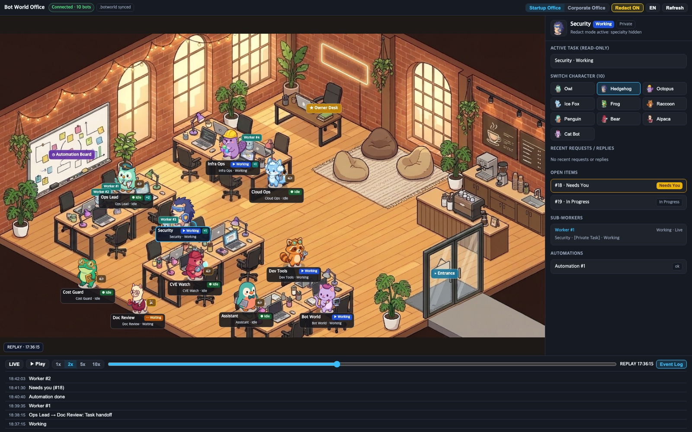
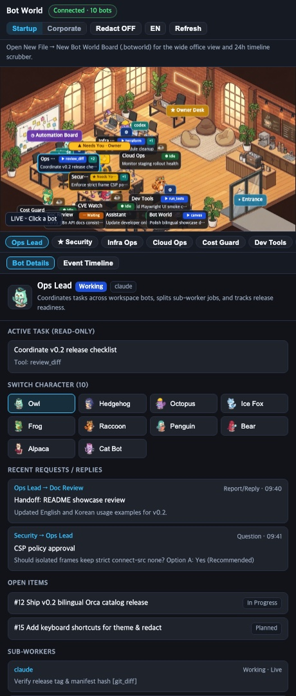

<div align="center">
  
  <h1>Bot World</h1>
  <p><strong>Read-only virtual office visualizer (HTML5 Canvas) for Orca bots and live sub-workers.</strong></p>
  <p>
    <code>Read-Only</code> · <code>Bilingual EN / 한국어</code> · <code>.botworld Wide Board</code> · <code>Redact Mode</code> · <code>24h Replay</code>
  </p>
  <br />
  
</div>

---

## Showcase Gallery

### Wide Office Board (`Startup Office` & `Corporate Office`)

Open a `.botworld` file (**New File → New Bot World Board**) for the full two-column office view with live desks, sub-worker helpers, speech bubbles, landmark callouts, and an interactive bot inspector.

| Startup Office | Corporate Office |
| :---: | :---: |
|  |  |
| *Warm studio floor plan with live desks, sub-workers, character switcher, and 24-hour event timeline.* | *Cool glass-walled office highlighting `Needs You` approval badges, open items, and automation status.* |

### Privacy & Time Travel (`Redact Mode` + `24h Timeline Replay`)

Toggle **Redact ON** to mask sensitive task titles, tool names, message summaries, and sub-worker providers, or scrub back through the past 24 hours at `1x`, `2x`, `5x`, or `10x` playback speed.

<div align="center">
  
</div>

### Compact Sidebar Panel

Keep a live office overview docked beside your code and terminals without leaving your workspace.

<table>
  <tr>
    <td width="280" align="center" valign="top">
      
    </td>
    <td valign="top">
      <h4>Everything at a glance in the Orca sidebar</h4>
      <ul>
        <li><strong>Instant Theme &amp; Privacy Toggles</strong>: Switch between <strong>Startup</strong> and <strong>Corporate</strong> themes, toggle <strong>Redact ON/OFF</strong>, and switch <strong>EN / 한</strong> directly from the top bar.</li>
        <li><strong>Live Bot Roster</strong>: Quick-select pills highlight bots awaiting your decision (<code>★</code>) alongside active status badges.</li>
        <li><strong>Bot Details &amp; Event Timeline Tabs</strong>: Inspect the active read-only task, recent requests/replies, open items, live sub-workers, linked automations, or switch to the chronological event timeline.</li>
        <li><strong>One-Click Character Picker</strong>: Override any bot's avatar across 10 animal characters right inside the detail pane.</li>
      </ul>
    </td>
  </tr>
</table>

---

## Key Features

- **Dual Surfaces**:
  - **Sidebar Panel (`Bot World`)**: Compact docked canvas, bot roster pills, detail inspector, and recent event timeline.
  - **Wide `.botworld` Office Board**: Create via **New File → New Bot World Board (`.botworld`)** for a full-screen 2-column stage with a **24-hour timeline scrubber** and replay controls. `.botworld` files store view preferences only (`themeId`, `redactMode`, `selectedBotId`, `botAppearances`) and never persist sensitive task text.
  - **Status Bar Summary (`bot-world-status`)**: Live counts of active bots, running sub-workers, and bots awaiting owner input (anonymized in Redact Mode).
- **Works with Any Orca Workspace**:
  - **0 to 15+ Bots**: Greets empty workspaces with 0-bot onboarding, seats up to 14 bots at dedicated theme desks, and automatically arranges 15+ bots in an overflow desk grid with compact nameplates.
  - **Role-Aware Avatar Matching + 1-Click Overrides**: Automatically assigns matching animal avatars from English or Korean role keywords (`security`, `infra`, `cloud`, `cost`, `docs`, `cve`, `assist`, `coord`, `tool`, etc.) with a deterministic fallback, and lets you swap any bot manually among 10 characters: `Owl`, `Hedgehog`, `Octopus`, `Ice Fox`, `Frog`, `Raccoon`, `Penguin`, `Bear`, `Alpaca`, and `Cat Bot`.
- **Bilingual UI (`Auto`, `English`, `한국어`)**: Follows Orca's UI locale automatically in `auto` mode, or can be pinned in Settings or via the toolbar `EN` / `한` toggle.
- **Redact Mode & 24h Timeline Replay**: Mask sensitive operational details on demand for screen sharing or demos, and replay up to 24 hours of recorded snapshots at `1x`, `2x`, `5x`, or `10x` speed.

---

## Quick Start & Installation

### Install from Orca Plugin Catalog / GitHub

```sh
orca plugin install ddochi-nyang/bot-world-plugin
```

### Local Development Load

```sh
git clone https://github.com/ddochi-nyang/bot-world-plugin.git
cd bot-world-plugin
orca plugin dev load .
```

### Opening the Views

1. **Sidebar Panel**: Click the **Bot World** status bar item or run the **Open Bot World** command.
2. **Wide Office Board**: Choose **New File → New Bot World Board (`.botworld`)** in Orca to open the wide 2-column office canvas and 24-hour timeline scrubber.

---

## Settings Reference

| Key | Type | Default | Description |
| --- | --- | --- | --- |
| `defaultTheme` | `string` (`startup_office`, `corporate_office`) | `startup_office` | Default office canvas theme (`Startup Office` or `Corporate Office`). |
| `redactMode` | `boolean` | `false` | Hide sensitive task titles, tool names, message bodies, and event summaries. |
| `pollIntervalSec` | `integer` (`2`–`60`) | `5` | Default status polling interval in seconds. |
| `language` | `string` (`auto`, `en`, `ko`) | `auto` | Display language for Bot World (`auto` follows Orca UI locale). |

---

## Security & Privacy Architecture

Bot World is engineered as a strictly read-only, zero-egress observer:

- **Least-Privilege Capabilities**: Requests only `agent:read`, `storage:own`, and `settings:own` — never write, terminal-send, or command-execution capabilities.
- **Strict Content Security Policy & Zero Network Egress**: Isolated custom editor frame (`frame: "isolated"`) with `connect-src 'none'`. No external HTTP requests, telemetry, or analytics.
- **XSS-Safe DOM & Safe Process Invocation**: Uses `textContent` and `createTextNode` exclusively (zero `innerHTML` or `eval`), and invokes Orca CLI reads via `execFile(..., { shell: false })` with a strict binary path allowlist, minimal environment variables, read-only subcommand allowlist, and argument validation.
- **Automatic Secret & PII Scrubbing + Redact Mode**: Masks AWS access keys, Slack/GitHub/Bearer/API tokens, webhook URLs, PEM private key blocks, email addresses, payment card numbers, and 12-digit AWS account IDs before storage or rendering, with one-click **Redact Mode** for presentations and screenshots.

---

## Verification

```sh
orca plugin validate . --json
orca plugin check . --json
orca plugin test . --json
```

---

## 한국어 요약 (Korean Overview)

**봇 월드 (Bot World)** 는 Orca 봇과 실시간 하위 워커의 협업 상태를 HTML5 Canvas 기반 가상 사무실로 시각화하는 **읽기 전용** 플러그인입니다.

- **이중 화면 구성**:
  - **우측 사이드바 패널 (`봇 월드`)**: 스타트업 / 대기업 사무실 테마 전환, 가림 모드(`가림 ON/OFF`), 언어 전환(`EN` / `한`), 봇별 진행 작업·요청/답변·세부 항목·하위 워커·정기 자동화 조회, 10종 동물 캐릭터 즉시 교체.
  - **넓은 `.botworld` 오피스 보드**: **새 파일 → 새 봇 월드 보드 (`.botworld`)** 로 생성하면 2단 전체 오피스 뷰와 **24시간 타임라인 스크러버(`1x / 2x / 5x / 10x` 재생)** 를 사용할 수 있습니다. `.botworld` 파일은 화면 설정(`themeId`, `redactMode`, `selectedBotId`, `botAppearances`)만 저장하며 민감한 작업 내용은 저장하지 않습니다.
- **모든 Orca 워크스페이스 자동 대응**: 봇이 없는 초기 안내 상태부터 14개 전용 책상, 15개 이상 봇을 위한 확장 좌석 그리드와 축약 이름표까지 자동으로 배치합니다. 영문·한글 역할 키워드(`security`, `infra`, `cloud`, `cost`, `docs`, `cve`, `보안`, `인프라` 등)에 맞춰 부엉이·고슴도치·문어·여우·개구리·너구리·펭귄·탐정 곰·알파카·고양이 봇 캐릭터를 자동 배정하며 클릭 한 번으로 바꿀 수 있습니다.
- **보안 및 개인정보 보호**: 최소 권한(`agent:read`, `storage:own`, `settings:own`), 외부 통신 차단 CSP(`connect-src 'none'`), `shell: false` 기반 읽기 전용 조회, `textContent` 전용 DOM, 비밀 키·토큰·이메일·카드번호·12자리 AWS 계정 ID 자동 마스킹 및 가림 모드를 제공합니다.
