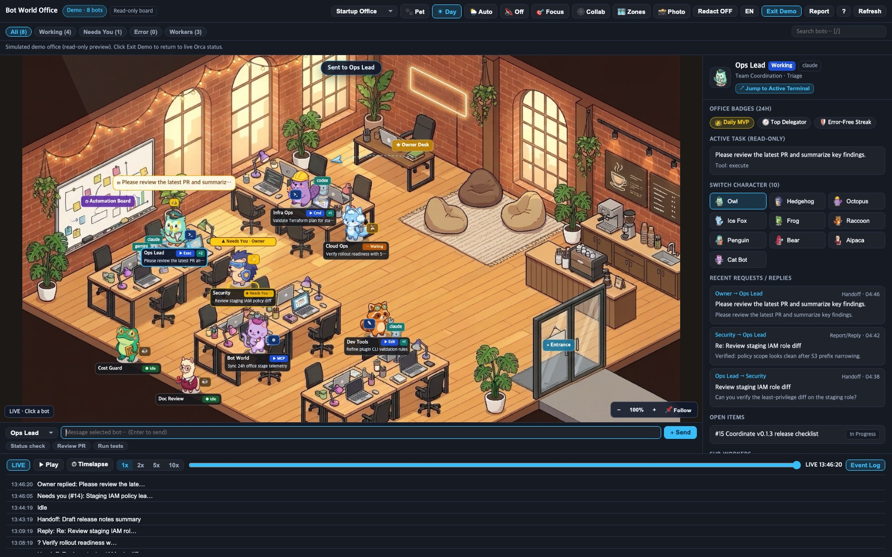
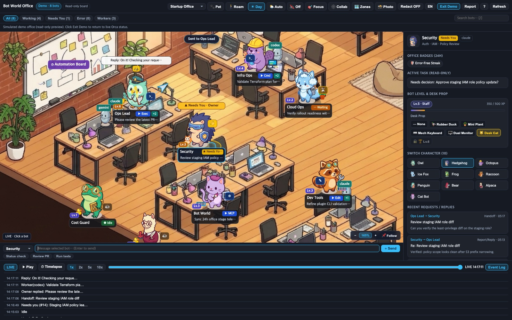
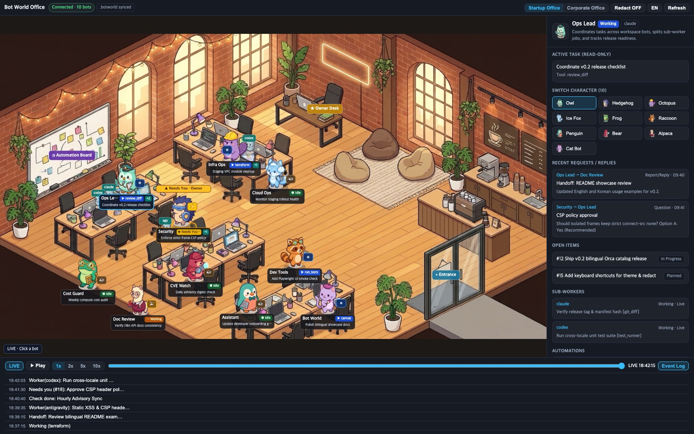
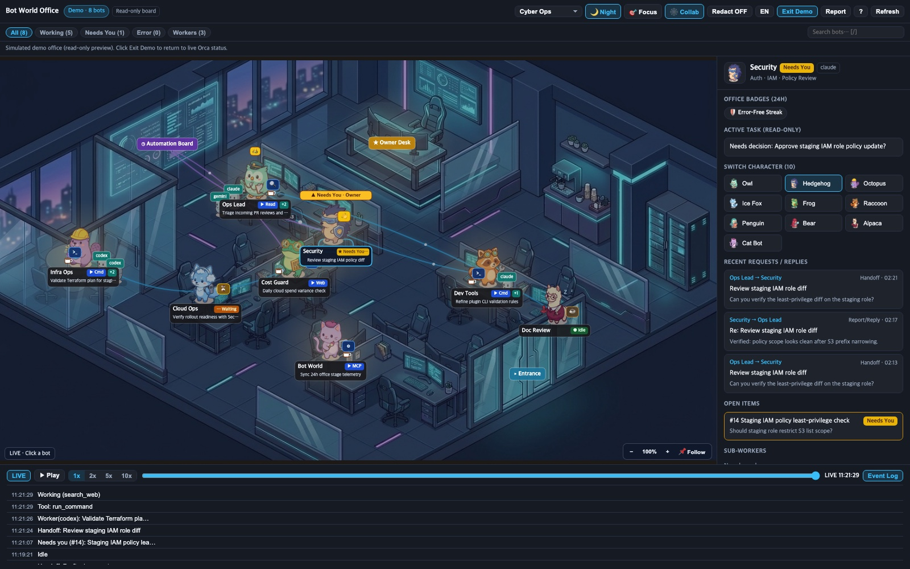

**English** · [한국어](./README.ko.md) · [Full Reference](./docs/REFERENCE.md)

# Bot World for Orca

**Turn your Orca bots and live sub-workers into a living isometric office, Pocket Pet terrarium, and local Bot RPG — read-only by default, with zero external network calls.**

   


*Virtual Office, Pocket Pet Terrarium (`G`), Bot RPG & Owner Roaming (`V`/`H`/`K`), Opt-In Quick Send, and 24h Office Digest (`I`) — all running locally inside Orca.*

## Quick Start

1. **Install** from the Orca catalog or load locally:
   ```sh
   orca plugin install ddochi-nyang/bot-world-plugin
   ```
   ```sh
   git clone https://github.com/ddochi-nyang/bot-world-plugin.git && cd bot-world-plugin && orca plugin dev load .
   ```
2. **Open a view**: Click **Bot World** in the Orca status bar (Sidebar Panel) or create **New File → New Bot World Board (`.botworld`)** for the full-screen 2-column stage and 24h timeline.
3. **Preview instantly**: Click **Try Demo Office** on an empty workspace (or **Demo** in the toolbar) to test live animations, RPG props, Pocket Pet toys, and Quick Send with zero CLI writes.

## Highlights

- **Living Virtual Office**
  - 4 themes (`Startup Office`, `Corporate Office`, `Cozy Cafe`, `Cyber Ops`) with `Auto`/`Day`/`Sunset`/`Night` lighting (`A`) and `Rain`/`Snow`/`Starlight` weather (`W`).
  - Zero-asset procedural Web Audio soundscape (`M`, off by default), drag-and-drop custom seating, and translucent `.botworld` Team Zones (`Z`).
- **Pocket Pet & Quick Send**
  - Switch to Pocket Pet Terrarium (`G`) in either the sidebar or `.botworld` board — pet bots for heart reactions or toss **☕ Coffee / 🎾 Ball / 🍪 Treat** toys.
  - Opt-in **Quick Send** paper planes from the Owner Desk (`allowQuickSend`, default `false`) plus 1-click **↗ Terminal** and **↗ Workspace** teleport.
- **Bot RPG & Owner Roaming**
  - Privacy-safe local XP & leveling (`Lv.1 Intern` → `Lv.6+ Archmage`) unlocks 6 pixel desk props (`🦆`, `🪴`, `⌨️`, `🖥️`, `🐱`, `🏆`) displayed right on each bot's desk.
  - Toggle **Owner Avatar Roaming** (`V`), walk with `WASD` / Arrow keys / canvas double-click, press `H` for **High-Five** (`+8 XP`) or `K` for **Hand Coffee** (`+10 XP`), and enjoy idle watercooler banter.
- **Replay, Digest & Sharing**
  - Scrub 24 hours of recorded snapshots, play a **10-second Daily Timelapse**, and inspect the **24h Office Digest** (`I`) with KPIs, Daily MVP badges, Bot Growth & Levels, a **7-Day Weekly Trend**, and 1-click **Copy Markdown**.
  - Export a clean **PNG Photo Card** (`P`) with dark-glass KPIs and Redact status locally.
- **Privacy-First by Design**
  - Read-only by default, one-click **Redact Mode** (`R`), strict `connect-src 'none'` CSP with zero telemetry/external network, and opt-in guards for Quick Send (`allowQuickSend: false`) and OS Desktop Notifications (`desktopNotifications: false`).

## Showcase

<table>
  <tr>
    <td width="50%" align="center" valign="top">
      
      <br /><strong>Owner Roaming &amp; RPG Desk Props (v0.8.0)</strong><br />
      <sub>Walk the floor (<code>V</code>), trigger proximity <code>H</code> High-Five / <code>K</code> Coffee, and unlock desk props.</sub>
    </td>
    <td width="50%" align="center" valign="top">
      
      <br /><strong>Pocket Pet Terrarium Mode</strong><br />
      <sub>Glass-knocking <code>Needs You</code> pets, headpats, and ☕/🎾/🍪 toys (<code>G</code>).</sub>
    </td>
  </tr>
  <tr>
    <td width="50%" align="center" valign="top">
      
      <br /><strong>Opt-In Quick Send Paper Planes</strong><br />
      <sub>Golden paper-plane dispatch from the Owner Desk (opt-in in Live Mode, active in Demo).</sub>
    </td>
    <td width="50%" align="center" valign="top">
      
      <br /><strong>Bot Level, XP Bar &amp; Prop Selector (v0.8.0)</strong><br />
      <sub>Inspect XP progress, interaction counts, and equip unlocked pixel desk props.</sub>
    </td>
  </tr>
  <tr>
    <td width="50%" align="center" valign="top">
      
      <br /><strong>Cozy Cafe Sunset + Rain &amp; Soundscape</strong><br />
      <sub>Themed ambient weather (<code>W</code>), Web Audio soundbed (<code>M</code>), and flying couriers.</sub>
    </td>
    <td width="50%" align="center" valign="top">
      
      <br /><strong>24h Office Digest, Bot Growth &amp; 7-Day Trend</strong><br />
      <sub>KPIs, Daily MVP badges, Bot Growth &amp; Levels, hourly chart, and Markdown export (<code>I</code>).</sub>
    </td>
  </tr>
</table>

<details>
<summary>More screenshots (8 additional views)</summary>

| View | Preview | View | Preview |
| :--- | :---: | :--- | :---: |
| **Startup Office** |  | **Corporate Office** |  |
| **Cyber Ops** |  | **Night Atmosphere** |  |
| **Team Zones (`Z`)** |  | **Redact & 24h Replay (`R`)** |  |
| **Collab Network (`C`)** |  | **Compact Sidebar Panel** |  |

</details>

## Essential Shortcuts

| Key | Action | Key | Action |
| :---: | :--- | :---: | :--- |
| `G` | Toggle Office ↔ Pocket Pet | `M` | Cycle sound (`Off` / `Chimes` / `Ambient`) |
| `V` | Toggle Owner Avatar Roaming (`WASD`/Arrows) | `I` | Open / close 24h Office Digest |
| `H` / `K` | High-Five / Hand Coffee to nearby bot | `P` | Save 1-click PNG Photo Card |
| `T` | Cycle 4 office themes | `R` | Toggle Redact Mode (`ON` / `OFF`) |
| `W` | Cycle weather (`Auto` / `Clear` / `Rain` / `Snow` / `Starlight`) | `?` | Open all keyboard shortcuts |

See [Full Shortcuts, Settings & Security Reference](./docs/REFERENCE.md) for all 20+ shortcuts, `.botworld` options, and RPG tables.

## Security & Privacy Summary

- **Read-Only & Opt-In Writes**: CLI polling uses a strict `assertAllowedSubcommand()` allowlist (`execFile`, `shell: false`). Both `allowQuickSend` and `desktopNotifications` default to `false`, and `workspace:write` is used solely for 1-click `terminal.focus` / `workspace.open` teleport.
- **Zero External Network**: Isolated custom editor frame (`frame: "isolated"`) with `connect-src 'none'`; all audio, particles, PNG photo cards, and XP storage run 100% locally.
- **PII Scrubbing & Redact Mode**: Secrets, tokens, emails, cards, and 12-digit AWS account IDs are masked before storage or rendering; `botWorld.weeklyTrend` and `botWorld.rpg.v1` store numeric rollups only.
- **XSS-Safe DOM**: Built exclusively with `textContent` and `createTextNode` (zero `innerHTML` or `eval`).

Full details: [Security & Permissions Reference](./docs/REFERENCE.md#security--permissions).

---

Licensed under the [MIT License](./LICENSE).
